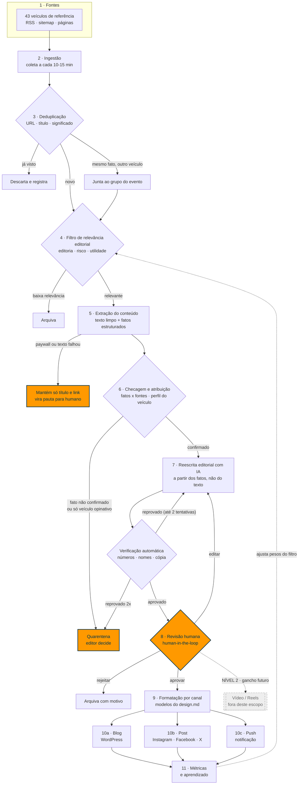

# Folha Metrópole — Arquitetura da automação de notícias (Nível 1: texto)

**Cliente:** Charles Lidberg · **Assessoria:** Expoente · **Data:** 19/10/2026
**Escopo:** pegar uma notícia de um veículo de referência e transformá-la em **blog + post + push**, com revisão humana. Vídeo é Nível 2 e está fora, só com o ponto de engate marcado.

> **Como ler este documento.** Ele complementa a auditoria já entregue (`Auditoria e Pipeline de Notícias`) e não a repete. Aquela auditoria listava fontes oficiais (Agência Brasil, Senado, IBGE...). Agora a entrada real do pipeline são os **43 veículos de referência** que o próprio Charles definiu, e isso muda duas coisas: a ética de uso (seção 3) e o tratamento de paywall e de veículos com linha editorial declarada (etapas 2, 5 e 6).
>
> **O que é medido e o que é ilustrativo.** O exemplo da seção 4 usa uma notícia real de hoje, a extração rodou de verdade, o agrupamento usa itens reais de feeds consultados hoje e a medição de similaridade foi calculada. O sistema completo ainda não existe: placares de relevância, ids e logs do sistema aparecem marcados como **ilustrativos** (têm o formato real, mas não saíram de uma máquina em produção).

---

## 1. Diagrama de fluxo



**Legenda:** caixas laranja = onde um humano entra ou decide. Caixa tracejada = Nível 2, não faz parte desta entrega. Toda seta de "descartar", "arquivar" e "quarentena" grava um motivo, nada some sem registro.

---

## 2. Etapa por etapa

Cada etapa segue o mesmo roteiro: **o que é · por que existe · tecnologia · se falhar · onde entra humano.**

### Etapa 1 — Fontes (os 43 veículos de referência)

- **O que é.** A lista que o Charles definiu: 24 do Brasil, 9 dos EUA e 10 da Europa. É a "banca de jornais" que o sistema lê todo dia.
- **Por que existe.** Dá ao sistema o mesmo repertório que a redação já usa e garante que a pauta nasce do que a Folha Metrópole considera referência.
- **Tecnologia.** Para cada veículo, o melhor canal disponível, nesta ordem: feed RSS, sitemap de notícias, página de seção. Ver o teste real de viabilidade no [Apêndice](#apêndice--viabilidade-dos-43-veículos-testada-ao-vivo).
- **Se falhar.** Se um feed muda de endereço ou cai, o sistema alerta no Telegram depois de 24 h sem item novo daquele veículo. Os demais seguem funcionando.
- **Humano.** Uma vez, na implantação: ratificar o **perfil de cada veículo** (A, B ou C, explicado na etapa 6). Depois disso, revisão trimestral.

### Etapa 2 — Ingestão

- **O que é.** O "carteiro": busca os itens novos de cada fonte e guarda título, resumo, link, data e autor.
- **Por que existe.** Sem coleta contínua não há matéria "do dia". Guardar o bruto também permite auditar depois de onde veio cada informação.
- **Tecnologia.** `feedparser` (RSS) e `httpx`, com `ETag/Last-Modified` para só baixar o que mudou. Identifica-se com User-Agent próprio, respeita `robots.txt` e limita a velocidade por domínio. Guarda tudo em Postgres. O texto completo só é buscado na etapa 5, e só para o que passar do filtro.
- **Se falhar.** Falha de rede: nova tentativa com espera crescente. Bloqueio do veículo (HTTP 403/402): a fonte entra em "pausada" e o sistema **não tenta contornar** a barreira, esse é um princípio do projeto.
- **Humano.** Nenhum no dia a dia. Só recebe o alerta de fonte parada.

### Etapa 3 — Deduplicação

- **O que é.** Descobrir que vários itens falam do mesmo fato e tratá-los como um só **evento**.
- **Por que existe.** Num dia, a mesma notícia chega por 5 veículos. Sem isso o jornal publicaria 5 textos iguais. E há um ganho extra: um evento coberto por vários veículos vira **um** texto, escrito a partir de **várias** fontes, o que reduz o risco de cópia e melhora a checagem.
- **Tecnologia.** Três camadas: (1) URL canônica sem parâmetros de rastreio; (2) título normalizado; (3) **similaridade de significado** por embeddings (vetores numéricos do texto, comparados no `pgvector`), com limiar inicial de 0,88 na janela das últimas 72 h. O limiar é calibrado nas duas primeiras semanas com dados reais.
- **Se falhar.** Falso positivo (juntar fatos diferentes) é pego na revisão, que mostra todos os itens do grupo. Falso negativo (não juntar) gera duas pautas parecidas; a segunda é descartada pelo editor, ou pelo aviso "evento já publicado".
- **Humano.** Só na calibração inicial e quando o editor corrige um agrupamento.

### Etapa 4 — Filtro de relevância editorial

- **O que é.** O "pauteiro" automático: dá uma nota ao evento e decide se vale virar matéria.
- **Por que existe.** Dos ~1.400 itens que os feeds testados entregaram numa única coleta, só uma fração interessa a um jornal com a linha da Folha Metrópole. Publicar tudo seria ruído; publicar pouco seria desperdício.
- **Tecnologia.** Um modelo de linguagem pequeno e barato lê título e resumo e responde em formato fixo (JSON): editoria, aderência ao perfil do jornal, urgência, utilidade pública, e **marcadores de risco** (crime, menor de idade, saúde, eleição, citação a empresas do Charles). As regras da casa ficam em lista configurável, não escondidas no prompt.
- **Se falhar.** Nota errada para cima: um item fraco chega à revisão e o editor rejeita (custo: segundos). Nota errada para baixo: uma boa pauta fica arquivada; por isso o arquivo é pesquisável e a etapa 11 mede esse caso.
- **Humano.** **Define as regras** (quais editorias priorizar, o que é "risco") e pode puxar manualmente qualquer item arquivado para a fila.

### Etapa 5 — Extração do conteúdo

- **O que é.** Abrir a página da matéria e separar o que é **texto jornalístico** do que é menu, anúncio e rodapé. Depois, transformar o texto em **fatos estruturados**: quem, o quê, quando, onde, números, declarações com autor.
- **Por que existe.** A reescrita parte dos **fatos**, não do texto original. Essa separação é a principal barreira técnica contra cópia: o redator de IA nunca "vê" frases para parafrasear, vê uma lista de afirmações.
- **Tecnologia.** `trafilatura` (extração de texto limpo; já testada no exemplo da seção 4) e um modelo de linguagem para produzir a lista de afirmações, cada uma ligada ao parágrafo e à URL de origem.
- **Se falhar.** Paywall (WSJ, FT, Bloomberg, Economist, Valor e outros) ou página que bloqueia robô: o sistema **não burla**. Fica só com título, resumo público e link, e o item vira **pauta para humano**, que pode apurar por outra fonte ou pela fonte primária.
- **Humano.** Só no caso de paywall/falha, para decidir se a pauta merece apuração própria.

### Etapa 6 — Checagem e atribuição de fonte

- **O que é.** Antes de escrever, o sistema responde: "isso é confiável o bastante para publicar, e de quem é a informação?".
- **Por que existe.** É o ponto em que uma notícia errada ou um boato de um único veículo seria barrado. E é aqui que se define **a quem o texto atribui cada afirmação**.
- **Tecnologia.** Regras por **perfil de veículo** (proposta; o Charles ratifica):
  - **A, agência/dado primário** (AP, Reuters, Bloomberg, dados oficiais): fato pode ser publicado com atribuição.
  - **B, jornalismo generalista ou econômico de referência**: fato publicável com atribuição; números relevantes pedem confirmação em segundo veículo **ou** fonte primária.
  - **C, veículo com linha editorial declarada**: serve como **pauta** e como **posição atribuída** ("segundo a Revista X"); um fato que só apareça em veículos C **não** é publicado como fato, vai para quarentena até haver confirmação em A ou B.
  Além disso: busca da fonte primária (órgão, comunicado, base de dados) e checagem cruzada de números entre os itens do evento.
- **Se falhar.** Sem confirmação suficiente: **quarentena**, o item vai ao editor com o motivo escrito ("número só aparece em um veículo").
- **Humano.** O editor decide em quarentena. Política e Justiça passam por humano em qualquer caso.

### Etapa 7 — Reescrita editorial com IA

- **O que é.** O modelo escreve a matéria no padrão da Folha Metrópole (título declarativo de 80–110 caracteres, linha fina, lide, intertítulos, tom neutro) **a partir da lista de fatos**, com a atribuição já embutida no texto.
- **Por que existe.** É o ganho de produtividade do projeto. Mas só serve se o texto sair original, correto e na voz do jornal.
- **Tecnologia.** Um modelo de linguagem de alta capacidade, com as regras de voz do [`design.md`](design.md) como instrução e 5 a 8 matérias reais do jornal como exemplo de estilo. Saída em formato fixo: título, linha fina, corpo, slug, tags, meta description, sugestão de imagem, bloco de fonte. Em seguida, **verificação automática**:
  1. cada número, nome e data do texto é conferido contra a lista de fatos;
  2. **teste de cópia**: sobreposição de sequências de 8 palavras contra a fonte (traduzida para o português quando a fonte é estrangeira) e semelhança de significado por parágrafo; limiar proposto ≤ 3% em 8-gramas, e nenhuma sequência literal acima de 12 palavras, exceto nomes, cargos e termos de dado;
  3. filtros de segurança editorial: sem acusação sem atribuição, presunção de inocência, sem nome de menor, sem recomendação médica.
- **Se falhar.** Reprovou na verificação: reescreve com a falha apontada, até 2 vezes. Reprovou duas vezes: vai à quarentena. O sistema nunca publica texto que não passou na verificação.
- **Humano.** Nenhum nesta etapa; o humano entra logo depois.

### Etapa 8 — Revisão humana (human-in-the-loop)

- **O que é.** Um editor vê o rascunho ao lado da fonte, com cada afirmação ligada ao seu trecho de origem, o relatório de cópia e as artes prontas. Decide: **aprovar, editar ou rejeitar**.
- **Por que existe.** Responsabilidade editorial é de pessoas. A IA acelera, mas quem assina é a redação.
- **Tecnologia.** Fila de revisão simples (no começo, mensagem no Telegram com botões Aprovar / Editar / Rejeitar e link de pré-visualização no WordPress; depois, um painel). Cada decisão grava revisor, hora e comentário.
- **Se falhar.** Se ninguém revisar no prazo, **nada é publicado**: o item espera. Para plantão, a regra de tempo é configurável, mas a aprovação continua obrigatória.
- **Humano.** **Sempre.** Nas primeiras 4 semanas, 100% das matérias. Depois, só editorias de baixo risco com dado oficial e verificação limpa podem ser publicadas direto, e **Polícia, Justiça, Saúde, Política e qualquer menção às empresas do Charles continuam sempre com humano.** Esta é a única etapa que dispara a publicação.

### Etapa 9 — Formatação por canal

- **O que é.** Transformar a matéria aprovada nos formatos de cada destino: corpo do blog, legenda do Instagram, texto do X, texto do Facebook, notificação push.
- **Por que existe.** Cada canal tem limite de tamanho e linguagem própria. Um texto único mal cortado gera manchete truncada e link quebrado.
- **Tecnologia.** Modelos de formatação do [`design.md`](design.md), aplicados por código (limites de caracteres validados antes de publicar) e pelo modelo de linguagem só para o encurtamento. Nenhum canal ganha informação que o blog não tenha.
- **Se falhar.** Texto estourou o limite: o validador devolve para encurtar; nunca corta no meio da frase.
- **Humano.** Já aprovou o conteúdo na etapa 8; vê as versões por canal na mesma tela e pode ajustar.

### Etapa 10 — Publicação (blog + post + push)

- **O que é.** Colocar no ar: matéria no WordPress, post nas redes, notificação push.
- **Por que existe.** É o fim visível do processo, e deve ser repetível e rastreável.
- **Tecnologia.** WordPress via REST API com Application Password (rascunho ou agendado), Rank Math preenchido, slot do banner afiliado preservado. Redes via APIs oficiais (Instagram Graph API; Facebook Pages). Push via a ferramenta que o site já usa. Cada publicação guarda o id externo.
- **Se falhar.** O WordPress hoje está atrás de Cloudflare e bloqueia chamadas externas: **sem liberação do IP da VPS pelo Gooweb a publicação automática não sai** (plano B: pacote pronto para colar). Falha de uma rede não derruba as outras; o sistema tenta de novo e avisa.
- **Humano.** Pode agendar horário; o push segue a regra de horário e urgência do `design.md`.

### Etapa 11 — Métricas e aprendizado

- **O que é.** Medir o que funcionou: leituras, cliques, tempo no texto, alcance e engajamento por canal, e também **qualidade do processo**: quanto o editor alterou, quantas rejeições, quais fontes mais rendem.
- **Por que existe.** Sem isso a automação publica por inércia. Com isso, o filtro de relevância (etapa 4) melhora com o uso.
- **Tecnologia.** Google Analytics 4 / Search Console para o blog, APIs das redes para os posts, e as próprias tabelas do sistema para o processo. Um painel semanal.
- **Se falhar.** Sem métricas o sistema continua publicando, só deixa de aprender. Alerta se o painel ficar 48 h sem dado.
- **Humano.** Revisa o relatório semanal e decide mudanças de linha (que editorias crescer, que fontes cortar).

---

## 3. Rastreabilidade e ética editorial

Este é o ponto mais sensível do projeto, porque a entrada são **veículos concorrentes e de referência**, não órgãos públicos. A regra de ouro: **o sistema reescreve fatos, nunca reproduz texto; e o veículo de origem é sempre creditado.**

### 3.1 Rastreabilidade: o sistema sempre sabe de onde veio cada frase

- Cada matéria tem **registro de origem**: URL, veículo, autor, data e hora da coleta, e o hash do conteúdo coletado.
- Cada **afirmação** do texto final aponta para o trecho e a fonte de onde saiu (tabela `article_claims`). O editor vê isso na revisão.
- Guardamos o prompt, a versão do modelo e a versão das regras usadas. Se alguém questionar uma matéria daqui a 6 meses, dá para reconstruir o caminho inteiro.
- **Nada é publicado sem pelo menos um item de fonte ligado.** Matéria sem origem registrada é bloqueada tecnicamente.

### 3.2 Como se evita plágio e cópia literal

1. **Reescrita a partir de fatos, não de texto** (etapas 5 e 7): o redator de IA recebe afirmações soltas, não parágrafos do veículo.
2. **Teste de cópia obrigatório** antes da revisão (etapa 7): sobreposição de 8 palavras, com fonte estrangeira comparada em tradução. Reprovou, não segue.
3. **Citações curtas e entre aspas, sempre atribuídas.** Declarações de entrevistados entram como citação identificada ("disse X, economista da Y"); trecho do próprio veículo, no máximo uma frase curta, entre aspas, quando for indispensável.
4. **Um evento, várias fontes.** Quando possível, o texto combina mais de um veículo, o que afasta a semelhança com qualquer um.
5. **Análise e opinião de terceiros não são reescritas.** Colunas, editoriais e reportagens exclusivas de investigação ficam fora da reescrita automática: viram pauta ou link com comentário da redação.
6. **Imagens.** Nunca reutilizar foto, gráfico ou vídeo de outro veículo. Capa e artes vêm de agência pública, banco licenciado, material próprio ou arte gerada pela redação (inclusive infográfico com os dados), e ilustração por IA fica sempre rotulada.
7. **Paywall não é contornado**, nem para ler (etapa 5).

### 3.3 Como fica o crédito ao veículo de origem

- **No texto**, a atribuição aparece onde a informação aparece: "segundo a BBC", "informou o Wall Street Journal".
- **No bloco de fonte**, ao fim do blog: veículo, autor quando houver, data e **link para a matéria original**. Exemplo da seção 4.
- **Nos posts**, uma linha "Fonte: BBC News" sempre presente, antes da chamada para o link.
- **Selo de IA.** "Texto produzido com apoio de inteligência artificial e revisado pela redação." Já é prática do jornal citar a matéria original quando contextualiza material de terceiros, o pipeline apenas formaliza.
- **Correções.** A editoria Errata já existe; o sistema liga cada correção à matéria e à afirmação alterada.

### 3.4 Pontos jurídicos que dependem de validação

> Não é parecer jurídico. São pontos que o Charles deve levar ao advogado do jornal **antes** de ligar o Nível 1 em produção.

1. **Fatos x forma.** Em geral, o fato noticiado não é protegido por direito autoral, a **forma de expressão** é (Lei 9.610/98, art. 8º, e a distinção ideia/expressão). A reescrita factual atende a esse desenho; a cópia não.
2. **Reprodução de notícia com menção da fonte.** A mesma lei prevê exceção para reprodução, na imprensa, de notícia ou artigo informativo publicado em outro veículo, com menção do autor e da publicação (art. 46, I, "a"). Os limites dessa exceção, principalmente com uso comercial e com veículos estrangeiros, precisam de leitura jurídica.
3. **Termos de uso de cada veículo.** O próprio feed da BBC, por exemplo, traz no cabeçalho um aviso de copyright com link para termos específicos sobre uso de RSS e metadados. Cada um dos 43 tem termos próprios; agências como AP, Reuters e Bloomberg costumam exigir **licença comercial** para reproduzir conteúdo. O sistema deve ter, por veículo, uma marca "licença verificada / não verificada".
4. **Paywall e extração automática.** Mesmo quando tecnicamente possível, acessar conteúdo pago por robô pode violar termos. O projeto **não** faz isso.
5. **Responsabilidade por erro.** O jornal responde pelo que publica, mesmo que o erro venha da fonte. Por isso as etapas 6 e 8.
6. **Pesquisa e eleição.** Brasil está em ciclo eleitoral (segundo turno em andamento): conteúdo político precisa de revisão humana reforçada e atenção às regras de propaganda e de pesquisa eleitoral.

---

## 4. Exemplo end-to-end com uma notícia real

### A notícia escolhida

| | |
|---|---|
| **Veículo** | BBC News (Reino Unido), um dos 10 veículos europeus da lista |
| **Título original** | *China's growth accelerates as AI boom helps boost exports* |
| **Autor** | Osmond Chia |
| **Publicada** | 19/10/2026 |
| **Link** | https://www.bbc.co.uk/news/articles/cm5yn098xz8lo |
| **Por que esta** | Economia/Mundo (editorias do jornal), tem números, atribuição clara de analistas, e foi publicada hoje; não envolve crime, menor, saúde nem candidato. A BBC é um perfil B (veículo de referência generalista). |

Reproduzimos aqui apenas o necessário (título, números e frases curtas) para demonstrar o processo. **O texto integral da BBC não está neste documento**, de propósito: é a mesma regra que o sistema vai seguir.

### Etapa 1–2 · Fonte e ingestão — *real*

O feed `https://feeds.bbci.co.uk/news/business/rss.xml` foi consultado hoje e entregou o item. O sistema guardaria:

```json
{
  "source": "BBC News",
  "profile": "B",
  "url_canonical": "https://www.bbc.co.uk/news/articles/cm5yn098xz8lo",
  "title": "China's growth accelerates as AI boom helps boost exports",
  "published_at": "2026-10-19",
  "feed_summary": "Exports have helped offset weak spending at home, but trade tensions and AI doubts cloud its outlook.",
  "collected_at": "2026-10-19T…",
  "status": "novo"
}
```

### Etapa 3 · Deduplicação — *itens reais, agrupamento descrito*

Na mesma coleta, outro veículo da lista publicou o mesmo fato:

| Veículo | Título | Uso no pipeline |
|---|---|---|
| BBC News | *China's growth accelerates as AI boom helps boost exports* | texto extraído (aberto) |
| The Wall Street Journal | *China's Economy Expanded 4.5% in Third Quarter, Powered by Exports* | **só título e link** (paywall): serve para confirmar o número de 4,5% |

As duas manchetes descrevem o mesmo evento, são agrupadas em um único **evento** e geram **uma** matéria. Itens relacionados que **não** entram no grupo (outro fato): *Chinese Exports Soar in September* (WSJ) e *Another warning sign for China's economy: falling consumer credit* (The Economist). Ficam como sugestões de "leia também".

### Etapa 4 · Relevância editorial — *saída ilustrativa, formato real*

```json
{
  "evento": "pib-china-3t-2026",
  "editoria": "Economia",
  "aderencia_perfil": 0.86,
  "urgencia": "media",
  "utilidade_publica": "media",
  "riscos": [],
  "citacao_empresa_charles": false,
  "decisao": "seguir",
  "rota": "revisao_humana_obrigatoria (fase inicial)"
}
```

Uma sugestão que o sistema levanta e **deixa à decisão do editor**: um "ângulo Brasil" (a China é parceira comercial central do país). Ele só entra no texto se o editor confirmar com fonte brasileira.

### Etapa 5 · Extração — *real (rodou)*

A extração com `trafilatura` devolveu título, autor, data e o texto limpo da página. A partir dele, o modelo produz a lista de afirmações; é ela, e não os parágrafos, que vai para o redator:

| # | Afirmação (fato) | Atribuição | Tipo |
|---|---|---|---|
| C1 | PIB da China cresceu 4,5% no 3º trimestre de 2026 | dados oficiais chineses, via BBC | número |
| C2 | Resultado é maior que o do trimestre anterior (menor em 3 anos) e menor que os 5% de jan–mar | BBC | número |
| C3 | Meta anual de Pequim: 4,5% a 5%; resultado no piso | BBC | número |
| C4 | Vendas de bens de alta tecnologia: +14,3% | dados oficiais, via BBC | número |
| C5 | Produção de baterias e de robôs industriais: +29% ou mais | dados oficiais, via BBC | número |
| C6 | Investimento imobiliário: queda superior a 20% em 9 meses | dados oficiais, via BBC | número |
| C7 | Superávit comercial caminha para superar o recorde de US$ 1,2 tri de 2025 | BBC | projeção |
| C8 | Sheana Yue (Oxford Economics): exportações de alta tecnologia seguram o crescimento; sem sinal de fim da crise imobiliária | citação de analista | declaração |
| C9 | Dave Chia (Moody's Analytics): risco de depender de "único motor externo"; efeitos das medidas de apoio ainda não aparecem | citação de analista | declaração |
| C10 | Escritório Nacional de Estatísticas: economia "manteve desenvolvimento estável sob pressão" | órgão oficial | declaração |
| C11 | Em setembro, Pequim anunciou juros menores para algumas empresas e subsídios a compradores de imóveis | BBC | fato |
| C12 | EUA e União Europeia reagem à entrada de produtos chineses baratos | BBC | fato |

### Etapa 6 · Checagem e atribuição — *real quanto ao cruzamento, parcial quanto à fonte primária*

- **C1 (4,5%)** aparece na BBC e no título do WSJ: **confirmado por dois veículos**.
- **Fonte primária:** os dados vêm do Escritório Nacional de Estatísticas da China. A busca automática no site do órgão é uma tarefa do sistema; **neste exemplo ela não foi executada**, e por isso o texto atribui à fonte oficial "segundo dados oficiais" via BBC, e não afirma ter consultado o órgão.
- C6 e C7 vêm de um único veículo: o sistema marca e o editor decide se mantém atribuído à BBC (foi o que o rascunho fez).
- Resultado: **segue**, com atribuição à BBC.

### Etapa 7 · Reescrita com IA — rascunho, medida real de cópia

O rascunho completo está no item a) Blog, mais abaixo. Resultado do teste de cópia, **calculado de verdade** comparando o rascunho com uma tradução literal da matéria original para o português:

| Teste | Resultado | Limiar proposto |
|---|---|---|
| Sequências de 8 palavras iguais à fonte | **0,5%** (2 de 402) | ≤ 3% |
| Sequências de 6 palavras | 4,0% (16 de 404) | só informativo |
| As 2 coincidências de 8 palavras | "a produção de baterias e de robôs industriais" e "superar o recorde de US$ 1,2 trilhão" | termos de dado, permitidos |

Conferência de fatos do rascunho contra a lista C1–C12: **todos os números e nomes conferem**. Na primeira versão do rascunho, a verificação pegou dois problemas que foram corrigidos: a meta de 4,5%–5% não estava no corpo, e o pacote de medidas de setembro estava atribuído ao economista, quando na fonte ele é narração do repórter.

### Etapa 8 · Revisão humana — *descrição*

O editor veria: matéria e fatos lado a lado, relatório de cópia (tabela acima), as artes, e os três botões. Pontos que mereceriam atenção neste caso: (1) manter ou não o "ângulo Brasil"; (2) a capa. A matéria é factual e de risco baixo, mas por ser fase inicial passaria por aprovação humana.

### Etapa 9–10 · Saída final

Os textos abaixo são a **saída final do sistema para esta notícia**, com a formatação do [`design.md`](design.md). As URLs são ilustrativas (não publicadas).

#### a) Blog

| Campo | Valor |
|---|---|
| Editoria | Economia (Mundo como secundária) |
| **Título (H1)** | Economia da China cresce 4,5% no 3º trimestre, puxada por exportações ligadas à inteligência artificial (103 caracteres) |
| Título SEO (≤ 60) | PIB da China cresce 4,5% no 3º trimestre de 2026 |
| Linha fina | Resultado fica no piso da meta oficial de Pequim, enquanto a queda de mais de 20% no investimento imobiliário continua pesando sobre o consumo. |
| Slug | `china-cresce-45-terceiro-trimestre-exportacoes-ia` |
| Meta description | PIB da China avança 4,5% no 3º trimestre de 2026, no piso da meta de Pequim, com exportações ligadas à IA; investimento em imóveis cai mais de 20%. |
| Palavra-chave | PIB da China |
| Tags | China, PIB, exportações, inteligência artificial, economia |
| Capa | Infográfico próprio da redação com os dados citados (sem foto de terceiros). Legenda: "Arte: Folha Metrópole, com dados do Escritório Nacional de Estatísticas da China" |

**Corpo:**

> A economia da China avançou 4,5% no terceiro trimestre de 2026, segundo dados oficiais divulgados nesta segunda-feira (19). O ritmo é superior ao do trimestre anterior, quando o país havia marcado o menor crescimento em três anos, mas ainda fica abaixo dos 5% do início do ano. O número está na faixa mais baixa da meta anual de Pequim, de 4,5% a 5%.
>
> ##### Exportações de tecnologia sustentam o resultado
>
> O avanço veio principalmente de fora para dentro. A demanda mundial por chips e componentes usados na construção de centros de dados de inteligência artificial fez as vendas de bens de alta tecnologia crescerem 14,3%. A produção de baterias e de robôs industriais subiu mais de 29%.
>
> Com isso, o superávit comercial chinês caminha para superar o recorde de US$ 1,2 trilhão registrado em 2025.
>
> ##### Consumo e imóveis seguem fracos
>
> Dentro do país, o quadro é diferente. O investimento em imóveis recuou mais de 20% nos nove primeiros meses do ano, na comparação com o mesmo período de 2025. O setor enfrenta uma crise de longa duração, herança de anos de construção em excesso e de endividamento das incorporadoras privadas.
>
> Salários que pouco crescem e o desemprego elevado entre os jovens completam o cenário que mantém as famílias cautelosas.
>
> ##### O que dizem os analistas
>
> Para Sheana Yue, pesquisadora da Oxford Economics, a indústria e as exportações de alta tecnologia seguram o crescimento, apesar do investimento e do gasto das famílias fracos. Ela avalia que não há sinal de fim para a crise imobiliária.
>
> Dave Chia, economista da Moody's Analytics, aponta como risco a dependência de um "único motor externo". Segundo ele, os efeitos das medidas de apoio direcionadas às empresas ainda não apareceram nos números. Em setembro, Pequim anunciou um pacote com juros menores para alguns negócios e subsídios a compradores de imóveis.
>
> ##### Pressão externa
>
> O Escritório Nacional de Estatísticas da China afirmou que a economia manteve "desenvolvimento estável sob pressão". Fora do país, porém, cresce a reação de Estados Unidos e União Europeia, cujos fabricantes têm dificuldade de competir com o volume de produtos chineses baratos. Também há dúvidas sobre se os bilhões investidos em infraestrutura de IA vão gerar o retorno prometido.
>
> **Fonte:** BBC News (reportagem de Osmond Chia, 19/10/2026), com dados do Escritório Nacional de Estatísticas da China. Texto reescrito pela redação da Folha Metrópole com apoio de inteligência artificial e revisado por editor.

*(O banner do Mercado Livre entra automaticamente depois do 2º parágrafo.)*

#### b) Post (Instagram; versões Facebook e X ao lado)

**Instagram, legenda (cartão de capa + 3 cards de texto, 1080 × 1350):**

```
Economia da China cresce 4,5% no 3º trimestre, puxada por exportações ligadas à IA

O ritmo supera o do trimestre anterior, o menor em três anos, mas fica no piso da meta de Pequim (4,5% a 5%).

O que pesou:
• Vendas de bens de alta tecnologia: +14,3%
• Produção de baterias e de robôs industriais: mais de 29%
• Investimento imobiliário: queda de mais de 20% em nove meses

Analistas alertam para a dependência de um "único motor externo": as exportações.

Fonte: BBC News, com dados do Escritório Nacional de Estatísticas da China. Texto produzido com apoio de IA e revisado pela redação.

Leia a matéria completa: link na bio.

#China #Economia #ComércioExterior #InteligênciaArtificial #FolhaMetrópole
```

**X (≤ 280 caracteres, link incluso):**

```
Economia da China cresce 4,5% no 3º trimestre, puxada por exportações ligadas à IA. Resultado fica no piso da meta de Pequim; investimento imobiliário cai mais de 20% no ano. Fonte: BBC. https://folhametropole.com/2026/10/china-cresce-45-terceiro-trimestre-exportacoes-ia/
```

**Facebook:** mesma legenda do Instagram, com o link da matéria no corpo no lugar de "link na bio".

#### c) Push

| Campo | Valor |
|---|---|
| Título (≤ 40) | China cresce 4,5% no 3º trimestre |
| Corpo (≤ 100) | Exportações de tecnologia ligadas à IA seguram o resultado; imóveis seguem em queda. |
| Urgência | U2, destaque (não é plantão) |
| Janela | dentro de 07h–21h; envio na primeira janela livre depois da publicação |

### Etapa 11 · Métricas — *descrição*

Para essa matéria, o sistema acompanharia: leituras e tempo no texto (GA4), origem do tráfego (push, Instagram, busca), cliques no link da bio, e quanto o editor alterou do rascunho. Os resultados de matérias de economia internacional alimentam o peso dessa editoria no filtro da etapa 4.

---

## 5. Stack proposta, alternativas e custo

### 5.1 Feito com ferramenta pronta × construído sob medida

| Componente | Pronta (usar) | Construir |
|---|---|---|
| Orquestração dos fluxos | **n8n** (self-hosted) ou cron + worker Python | A lógica de cada etapa, versionada em git |
| Coleta de feeds / extração | `feedparser`, `trafilatura`, `httpx` | Adaptadores por veículo (43 fontes: 30 responderam no teste, o resto precisa de endereço ou de outro método) |
| Banco | **Postgres + pgvector** (container novo) | Modelo de dados do pipeline (itens, eventos, fatos, rascunhos, revisões) |
| Dedup / similaridade | embeddings por API + `pgvector` | Regras de limiar e calibração com dados do jornal |
| Triagem, extração, redação | LLM por API | **Prompts, regras de voz, verificação de fatos e teste de cópia**, o coração do produto |
| Revisão humana | Telegram (MVP) / Retool ou Supabase (painel) | Fila, regras de rota por risco, trilha de auditoria |
| Publicação blog | **WordPress REST** + Rank Math | Conector com blocos Gutenberg, slot do banner afiliado, upload de mídia |
| Publicação social | **Instagram Graph API**, Facebook Pages API | Renderização de cards (HTML → PNG com Playwright) e validação por canal |
| Push | a ferramenta de push que o site já usa | Integração e regras de horário/urgência |
| Métricas | GA4, Search Console, APIs das redes | Painel semanal e ligação com o filtro de relevância |

### 5.2 Alternativas relevantes

| Decisão | Opção A (recomendada) | Opção B | Quando B |
|---|---|---|---|
| Orquestração | **n8n** no VPS (visual, o Charles ou a equipe conseguem entender) | Worker Python + `pm2` | Se quiserem mais controle e menos dependência de interface |
| LLM | Modelo forte para redação/verificação + modelo barato para triagem | Um só modelo para tudo | Só se o volume for baixo (simplicidade > custo) |
| Embeddings | API (rápido, barato) | Local no Ollama | O Ollama do VPS tem um bug de AVX512 já conhecido; por API evita o problema |
| Revisão | Telegram no começo | Painel web | Quando houver mais de 1 editor e mais de ~15 itens/dia |
| Fontes pagas (WSJ, FT, Bloomberg, Economist, Valor) | Só título + link, e pauta para humano | Contratar API/licença | Se o Charles quiser usá-las como fato-base legalmente |

### 5.3 Custo estimado por volume

> **Estimativa**, sem proposta formal: preços de API variam e devem ser revalidados na contratação. Em reais, câmbio de referência ~R$ 5,70/US$ (premissa). Infra usa o VPS já existente (custo incremental ~0).

| Item (US$/mês) | 5 notícias/dia (~150/mês) | 15 notícias/dia (~450/mês) | 30 notícias/dia (~900/mês) |
|---|---|---|---|
| Redação + verificação (modelo forte) | 25–60 | 75–180 | 150–360 |
| Triagem + extração (modelo barato, ~1,5–3 mil itens/dia lidos de 43 fontes) | 15–40 | 15–40 | 15–40 |
| Embeddings | 2–6 | 2–6 | 2–8 |
| Imagens por IA (só como apoio rotulado) | 0–20 | 0–40 | 0–60 |
| Armazenamento de mídia | 1–5 | 3–10 | 5–15 |
| **Total** | **≈ 45–130** (R$ 260–740) | **≈ 95–275** (R$ 540–1.570) | **≈ 170–480** (R$ 970–2.740) |

**O custo que não aparece na tabela é o do editor.** Revisar com atenção leva em média alguns minutos por matéria. A 5 por dia são cerca de 25–40 min diários; a 30 por dia, 2,5 a 4 horas. O gargalo da automação é a revisão, não o custo de IA, e por isso o volume deve crescer em degraus, medindo o tempo real do editor.

Isto revisa **para cima o teto** da estimativa da auditoria anterior (US$ 40–100 sem vídeo para 150 matérias), porque agora são 43 fontes de leitura, em vez de 17.

---

## 6. Roadmap

### Roda já no Nível 1 (texto)

| Fase | O que entra | Tempo |
|---|---|---|
| 0 | Acessos: Application Password do WordPress, liberação do IP da VPS no Cloudflare (Gooweb), token do Instagram, termos de uso por veículo | 2–3 dias, depende de terceiros |
| 1 | Ingestão dos veículos com feed ativo (30 de 43) + banco + deduplicação | ~1 semana |
| 2 | Filtro de relevância + extração + checagem + reescrita + verificação de cópia, com **rascunho no WordPress** | ~1,5 semana |
| 3 | Fila de revisão (Telegram) + formatação por canal + posts + push | ~1 semana |
| 4 | Métricas + painel semanal | ~3–4 dias |

**MVP em ~2 semanas:** 8–10 veículos, 1 editoria (Economia/Mundo), blog em rascunho com revisão humana em 100%. Ponto de decisão do Charles para ampliar fontes e liberar publicação direta nas editorias de baixo risco.

### Gancho do Nível 2 (vídeo)

Depois da aprovação na etapa 8, a matéria aprovada pode alimentar um roteiro curto para vídeo (marcado no diagrama). **Nada do Nível 2 está incluído, orçado ou prometido aqui.** Só foi garantido que a arquitetura já guarda o que um vídeo precisaria: texto aprovado, lista de fatos com fonte e artes aprovadas.

---

## 7. Decisões que precisam do Charles

1. **Política de fontes.** Ratificar o **perfil A/B/C** de cada um dos 43 veículos (Apêndice). Em especial: os veículos de linha editorial declarada (C) podem ser usados só como pauta/posição atribuída?
2. **Licenciamento.** Autoriza o advogado a validar os termos de uso dos veículos e a lei de direitos autorais (seção 3.4)? Quer contratar licença de alguma agência (AP, Reuters, Bloomberg) para usar como fato-base?
3. **Paywall.** Confirma que veículos pagos (WSJ, FT, Bloomberg, Economist, Valor etc.) entram só como título + link + pauta para humano, sem contornar o acesso?
4. **Selo de IA.** Aprova o texto "produzido com apoio de inteligência artificial e revisado pela redação" em todas as matérias, e o modelo de bloco de fonte?
5. **Quem revisa.** Quem é o editor responsável, em que horários, e qual o prazo máximo de aprovação? Sem editor definido, o sistema não publica.
6. **Autopublicação.** Em quais editorias, depois de quantas semanas e com que nota mínima, o sistema pode publicar direto? (Proposta: só após 4 semanas e só em baixo risco; Política, Justiça, Polícia, Saúde e menções ao Charles sempre com humano.)
7. **Conflito de interesse.** Passar a lista de empresas e projetos do Charles que exigem nota de divulgação.
8. **Capa e imagens.** Autoriza capa em infográfico/arte própria quando não houver foto livre? Há banco de imagens licenciado?
9. **Acessos técnicos.** Pedir ao Gooweb: usuário e Application Password do WordPress, liberação do IP da VPS na Cloudflare; e passar o token da conta Business do Instagram.
10. **Push.** Qual ferramenta de push o site usa e quem controla? Confirmar a regra de horário (07h–21h) e o limite diário.
11. **Eleições.** Como tratar conteúdo político durante o ciclo eleitoral (humano obrigatório, tom, pesquisas)?
12. **Vídeo (Nível 2).** Seguir com o planejamento depois que o Nível 1 estiver estável?

---

## Apêndice — Viabilidade dos 43 veículos (testada ao vivo)

Teste feito em 19/10/2026 a partir do VPS, com um endereço de feed por veículo (um ou dois endereços conhecidos). **"Não respondeu" não quer dizer que o veículo não tenha feed**, quer dizer que os endereços testados falharam ou bloquearam o acesso; esses precisam de um segundo método (sitemap de notícias, página de seção, ou API/licença). A coluna "Perfil" é uma **proposta** para o Charles ratificar: **A** agência/dado primário, **B** jornalismo generalista ou econômico de referência, **C** linha editorial declarada (usar como pauta e posição atribuída).

| Região | Veículo | Perfil proposto | RSS no teste (19/10/2026) | Itens no feed |
|---|---|---|---|---|
| Brasil | BandNews | B | não respondeu (HTTP 404) | — |
| Brasil | Brasil Paralelo | C | não respondeu (HTTP 308) | — |
| Brasil | CNN Brasil | B | responde | 42 |
| Brasil | Conexão Política | C | responde | 20 |
| Brasil | Correio Braziliense | B | responde | 20 |
| Brasil | Diario de Pernambuco | B | não respondeu (HTTP 403) | — |
| Brasil | Estadão | B | responde | 53 |
| Brasil | Folha de S.Paulo | B | responde | 100 |
| Brasil | G1 | B | responde | 99 |
| Brasil | Gazeta do Povo | B | não respondeu (HTTP 403) | — |
| Brasil | JC (PE) | B | não respondeu (HTTP 404) | — |
| Brasil | Jovem Pan | B | responde | 10 |
| Brasil | Metrópoles | B | responde | 20 |
| Brasil | O Antagonista | C | responde | 15 |
| Brasil | O Globo | B | não respondeu | — |
| Brasil | Pleno.News | C | responde | 30 |
| Brasil | Poder360 | B | responde | 10 |
| Brasil | LeoDias | B | responde | 10 |
| Brasil | R7 | B | responde | 100 |
| Brasil | Crusoé | C | responde | 15 |
| Brasil | Revista Oeste | C | responde | 10 |
| Brasil | SBT News | B | não respondeu (HTTP 404) | — |
| Brasil | Epoch Times BR | C | não respondeu | — |
| Brasil | Valor | B | responde | 100 |
| EUA | AP | A | não respondeu (HTTP 403) | — |
| EUA | Axios | B | responde | 36 |
| EUA | Bloomberg | A | responde | 20 |
| EUA | National Review | C | responde | 20 |
| EUA | NY Post | B | responde | 23 |
| EUA | Reuters | A | não respondeu | — |
| EUA | The Hill | B | responde | 100 |
| EUA | WSJ | B | responde | 72 |
| EUA | Wash. Examiner | C | responde | 10 |
| Europa | ABC (ES) | B | responde | 25 |
| Europa | BBC | B | responde | 29 |
| Europa | Corriere | B | não respondeu | — |
| Europa | Die Welt | B | responde | 30 |
| Europa | Euronews | B | responde | 50 |
| Europa | FT | B | responde | 10 |
| Europa | Le Figaro | B | não respondeu (HTTP 403) | — |
| Europa | NZZ | B | responde | 16 |
| Europa | Telegraph | B | não respondeu (HTTP 402) | — |
| Europa | Economist | B | responde | 300 |

**Resumo:** 30 de 43 responderam (~1.400 itens numa única coleta). Os 13 que não responderam: precisam de investigação individual na Fase 1. Nenhum bloqueio foi contornado; o objetivo do teste era só medir o que é acessível de forma aberta.
